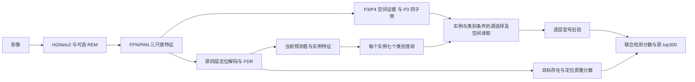

# SAR-AIRcraft：子带条件类别查询的完整方法研究规格

日期：2026-11-01。状态：完整模块已实现；用户将首轮正式实验指定为 102 轮，尚无服务器训练结果。
设计依据：main revision 0c27773；实现基于 main revision 8eff55a。
完整实现、验证范围和服务器启动命令见 [102 轮实验交接](sar_bccq_102e_experiment.md)。
本轮同时查阅原始论文，并在临时目录阅读 INTR 与 BHCL 官方源码。

## 1. 目标与结论

本候选以**完整方法**为实验单位。第一轮包含实例条件类别查询、子带/空间证据路由、逐层解码、
型号与检测质量的分解监督，以及普通、aux、DN 的完整训练路径。

工作目标暂定为：**独立完整模块相对同协议 baseline，COCO AP@[.50:.95] 提升 1.5–2.0 个百分点**。
首轮以 val AP 作为主筛选指标，按 val AP 选 checkpoint，并统一报告该 checkpoint 的 test 结果。
REM 组合的增量另记为 AP(REM+本模块)−AP(REM)，不能与独立模块收益混用或直接相加。
训练前没有依据承诺达到这个幅度；目标是据现有证据选择值得投入一次完整训练的候选。

推荐候选暂称 **BCCQ：Band-Conditioned Class Queries，子带条件类别查询**。
核心假设是：细粒度型号判别需要按实例、按类别读取不同的结构与方向细节；
单个共享 Query 和类别无关的频带增强，可能不足以完成这种选择。

## 2. 仓库证据如何约束设计

| 已有证据 | 对本方案的实际含义 |
|---|---|
| 旧诊断：val 与 test 的类别混淆和方法排序不同 | 需要同时报告跨划分泛化，不能把 test 探针收益当成 val 预期收益 |
| MPQ-single：102 轮 val 64.36，对照 baseline 64.51；test 也未显示收益 | 再给共享 Query 增加一个辅助原型头，现有证据不足以支持优先投入 |
| 类别概率结构的 val 拟合重排在旧 test 上有收益 | 类别竞争包含可用信号；这是方向依据，不等于新训练模块的收益 |
| REM 102 轮配对诊断：AP 64.5077→65.2237，A330 +5.1401、A220 −1.9668 | 类别受益不均；按类别选择证据是值得检验的假设，具体频带原因尚未证明 |
| 当前 REM 作用于 stride-8 投影特征；之后还有 FPN/PAN 和共享解码 | 可在分类证据的读取阶段形成与 REM 不同的作用机制 |

这些数字来自仓库既有记录，本轮没有重新导出预测。不同训练轮数的结果不交叉作差。
CLCR、SDCP、OST-DA 等有实现和实验交接，但本地没有齐全训练结果，不能统称为已经失败。

七类宏平均 AP 提升 1.5–2.0，意味着各类 AP 增量之和需达到 10.5–14.0。
只恢复 A220 的 1.9668 点，整体仅增加约 0.2810 点。
因此本候选面向全部七类，不围绕单个已知类别设置特殊分支、混淆对或阈值。

本节依据：[研究诊断](research_diagnosis_2026-10-28.md)、
[REM 配对诊断](sar_rem_mechanism_probe.md)、[MPQ 规格](sar_mpq_experiments.md)。

## 3. 文献筛选及创新边界

| 原始工作 | 核对到的证据 | 本项目如何使用 |
|---|---|---|
| BHCL，CVPR 2026 | 完整方案在 ShipRSImageNet 的 RHINO 上 AP50:95 59.78→61.41（+1.63）；OrientedFormer 63.17→64.32（+1.15）；FAIR1M-v1.0 AP50 +0.35 | 支持任务专用解码和判别监督协同；层级标签、Other 重分配与我们七类任务不直接等价 |
| INTR，ICLR 2024 | 类别查询先从图像提取类别相关证据，再用共享 presence 读出；官方实现用交叉熵训练 | 作为类别条件证据提取的直接参考；原任务是图像分类，没有本项目的 AP 结果 |
| Classification Matters，ECCV 2024 | 已有实例与类别联合条件的分类解码，并区分定位与分类 | 单独使用“每实例七个类别查询”不足以作为本项目新的贡献 |
| WD-FQDet，2026 预印本 | 已有小波分解与频率感知查询，面向红外/可见光互补 | 单独组合“小波+Query”也不足以构成新的贡献；需区分跨模态选频与按型号读取方向子带 |
| FreqFusion，TPAMI 2024 | 官方检测表：Faster R-CNN R50 37.5→39.4（+1.9 AP），R101 39.4→41.0（+1.6） | 完整融合模块的备用研究路线；自然图像/FPN 收益不能直接转为 DEIM/SAR 收益 |

本候选要检验的具体贡献是：**在一个候选目标内部，由类别查询联合决定证据源的使用比例与各源中的空间关注位置，
保留原空间细节和带符号方向子带，并让这种选择实际参与逐层型号预测。**
普通类别查询、任务解耦、Haar、分解置信度均有先例，分别归因和引用。
当前检索仅用于建立相关工作边界，不能据此宣称“首次提出”。

原始来源：

- [BHCL 论文，第 3 节及表 1](https://arxiv.org/html/2512.24074v1)；[官方代码](https://github.com/chncdx/BHCL)。
- [INTR 论文，第 3 节](https://arxiv.org/html/2311.04157v2)；[官方代码](https://github.com/Imageomics/INTR)。
- [Classification Matters，第 4 节及附录 E](https://arxiv.org/html/2407.19698v4)；[官方代码](https://github.com/naver-ai/class-query-vad)。
- [WD-FQDet，第 3.5 节](https://arxiv.org/html/2605.13621v1)。
- [FreqFusion 论文](https://arxiv.org/abs/2408.12879)；[官方代码与检测结果表](https://github.com/Linwei-Chen/FreqFusion)。
- [PROB：目标性与类别概率的分解先例](https://openaccess.thecvf.com/content/CVPR2023/papers/Zohar_PROB_Probabilistic_Objectness_for_Open_World_Object_Detection_CVPR_2023_paper.pdf)。

## 4. 完整结构

### 4.1 保留原空间证据，并显式提供四个方向子带

用两个独立、无偏置的 1×1 投影将 FPN 输出 P3、P4 从 256 通道变为 d=128。
对投影后的 P3 做一次固定 Haar 分解，得到 LL、LH、HL、HH。
六个证据源是：P3 空间、P4 空间，以及 P3 的四个子带。

原空间路径保留细节读取通路；子带提供另一组结构与方向表示。
四个子带的值保持符号，不将它们全部替换为幅值或能量。
这些是学习特征的频带，不将其解释为定标 SAR 散射功率。
使用 FPN 输出派生证据，使该模块单独开启和与 REM 组合时具有相同定义，不依赖读取某个 REM 变体的私有中间量。

每一层按该层预测框，在每个源上采样 5×5 token。
固定相对坐标为 {-0.4,−0.2,0,0.2,0.4}²，加入源标识与固定相对位置编码。
源的实际空间尺寸决定采样坐标映射；不能把子带下标当成原 P3 下标。
不要求额外部件标注，也不预先将 token 命名为机头、翼尖等语义部件。

### 4.2 每个实例的七个类别查询逐层更新

每个候选目标 i 建立七个 d 维状态，而非全图只建立七个共享状态：

\[
t^0_{i,c}=\operatorname{LN}(W_I\operatorname{sg}(q_i^0))+e_c.
\]

这里 sg 表示停止梯度，q_i^0 为当前原生候选 Query。
每层将当前预测框的坐标编码加入查询位置部分；七个状态先进行实例内部的类别自注意力，
再读取六源证据，经过残差、归一化和 FFN，传给下一层。
四层均执行完整分类路径，推理也保留四层状态更新。
各实例不通过这一分类自注意力混合，原定位解码器仍处理候选之间的关系。
新增分类参数使用常规可学习初始化，质量头采用低目标先验偏置；从第 0 轮随原 warmup 联合训练，
不复用 MPQ 的 epoch49 延迟激活，不对核心分支设置全零权重及全零外门控。

分类采样参考框同样使用 detached 值，语义损失不直接沿采样坐标改变框。
骨干和金字塔仍共享，不能称为分类与定位的所有梯度完全隔离。

### 4.3 将“选哪类证据”与“在该证据中看哪里”联合建模

记该层源 b 的视觉 token 为 x_{i,b,n}。先在各源内部计算空间注意力：

\[
\alpha_{i,c,b,n}=\operatorname{softmax}_n
\left(\langle W_Qt_{i,c},W_Kx_{i,b,n}+p_n+e_b\rangle/\sqrt d\right).
\]

源摘要使用加入位置/源编码前的视觉均值和 RMS：

\[
r_{i,b}=G([\operatorname{mean}_n x_{i,b,n},
\sqrt{\operatorname{mean}_n x_{i,b,n}^2+\epsilon}]).
\]

G 为共享 Linear(256,128)+SiLU。由不同的门控投影产生源权重：

\[
g_{i,c,b}=\operatorname{softmax}_b
\left(\langle W^g_Qt_{i,c},W^g_Kr_{i,b}+e_b\rangle/\sqrt d\right),
\qquad
u_{i,c}=\sum_b g_{i,c,b}\sum_n\alpha_{i,c,b,n}W_Vx_{i,b,n}.
\]

采用四头计算，上式省略头下标；u 经输出投影后进入残差与 FFN。
空间权重在每个源内归一化，源权重由实例内容和类别状态共同决定。
不固定某种型号必须使用 LL 或某个高频方向。

门控具有独立参数和源统计，不能改写成对同一注意力 logits 的简单 logsumexp 后宣称新增机制。
同理，简单对所有类别减去同一公共响应，再用共享线性读出及 softmax，可能只改变温度；
本方案的类别条件读取发生在非线性多层表示过程中，不以这种公共减法作为创新。

### 4.4 型号后验与检测质量分开监督

以同一个 presence 向量读出各类别状态：

\[
a_{i,c}=w^Tt_{i,c},\qquad
\pi_{i,c}=\operatorname{softmax}_c(a_{i,c}),\qquad
s_{i,c}=Q_i\pi_{i,c}.
\]

\(Q_i=\sigma(o(q_i^{loc})+\mathrm{LQE}(edge_i))\) 为单个候选的目标存在/几何质量分数。
LQE 沿用原边分布统计和 reg_conf，每层新增一个 256→1 的目标性读出。
七类包括原 other；other 不重标成父类别，也不强行学习单一紧致原型。

训练完整包含：

- 型号项：原分类匹配正样本上的七类 CE，系数 1；不以 IoU 缩小型号标签。
- 质量项：正样本目标为 detached IoU^gamma，未匹配为 0；gamma 沿用当前 1.5，
  正样本权重 1，负样本权重沿用 mal_alpha×Q^gamma；全局 GT 数归一化，系数 1。
- 原 L1、GIoU、FGL、DDF 及其系数；DDF 的质量读数应明确接收最终联合分数。
- 四层普通/aux 输出均提供型号与质量字段；DN 正样本有型号 CE 和质量监督，DN 负样本只训练质量为 0。
- encoder 候选选择与 pre-output 保留原七类 MAL 监督；最终检测分类路径使用分解目标，不能再叠加同一路的七类 MAL。

联合分数需同时用于该分支的匹配和后处理。实现时可计算稳定的 logit(s) 接入现有 sigmoid 分数接口，
新增 CE/质量损失直接读取各自 logits，不将 logit(s) 再送入 softmax。
训练不使用 GT 框代替分类分支的预测框采样，推理无需 GT。

## 5. 与仓库已有模块的区别

| 模块 | 当前主要作用 | BCCQ 要验证的新增机制 |
|---|---|---|
| MPQ | 对共享 Query 的训练期原型约束，推理不执行 | 类别条件的视觉读取直接进入推理和逐层预测 |
| SDCP | 框内网格平均池化与余弦分类 | 每个类别读取不同位置、不同源，保留 token 结构 |
| SLQC | 最终层局部布局增强一个分类 Query | 四层七类状态、显式源路由与分解监督 |
| CLCR/Lite | 几何/竞争统计的 logit 残差校准 | 形成新的分类证据，不仅修正原分数 |
| REM/per_band | 特征增强、全局共享或子带标量残差 | 每个实例、每个类别各自读取证据，作用于后续决策 |
| OST-DA | 改变共享解码的几何采样方式 | 专用分类状态及其证据组织方式 |

## 6. 静态预算和可实现性

草案固定 d=128、4 头、FFN=512、4 层、6 源、每源 25 token、普通 Query=300。
按上述线性层、MHA、三组 LayerNorm、共享投影/摘要/读出、坐标编码及四个质量头计：

- 每层分类块 297,600 参数，四层 1,190,400。
- 实际构建核对：BCCQ 分支有 **1,341,956** 个参数；删除三个不再使用的旧分类头后，整网净增 **1,336,559** 个可训练参数。
- 640 输入时源图共 14,400 个位置，每层每图 ROI token 共 45,000 个。
- 将 K/V 的线性投影放在整张源图上执行，再按框采样，线性层与注意力矩阵乘法预算约 **4.94 GMAC/图**。

投影与采样重排要求保持相同的线性算子及边界扩展，且中间没有归一化/激活；不满足时不能声称等价。
K/V 在类别间共享，不生成七份源特征图。
预算不包括 grid_sample、Haar、softmax、归一化及逐元素运算，不是整网 MAC、FLOPs 或 GPU 时延。
DN 会增加训练 Query 数；双卡 24GB 的峰值显存与吞吐尚无实测。
参数已通过实际配置构建确认；GMAC 仍为独立算术预算。已验证完整 DEIM-M 的联合反向传播，未执行 SAR 数据训练。
实现采用 query_chunk_size=64 和非重入激活重计算，保持完整的六源与四层计算；本地验证分块/重计算的输出和梯度一致性。

## 7. 首轮完整验证与后续消融

首轮实验为 baseline+BCCQ 完整方案，独立新配置和实验目录。
四个核心部分全部开启；按用户要求从同一 COCO M 初始化，完整训练 102 轮。
沿用双 GPU0/1、全局 batch28、seed0、480–800 训练多尺度/640 评估、warmup2000、
flat49、no_aug12、lr_gamma0.5、policy[4,49,90]、MixUp[4,49]、stop90、
AdamW 主 LR3.5e-4/骨干3.5e-5、WD1e-4、EMA、SyncBN、AMP 和原评估 top300。
RandomZoomOut/RandomIoUCrop 仍按冻结协议关闭。
这组不另加 SCS、MPQ、CLCR、SDCP 或 OST-DA；BCCQ 自身各组成均完整验证。

先用完整方案回答主假设，再按结果安排机制消融：

1. 完整 BCCQ 与同协议 baseline，报告最佳 val AP 对应同一 checkpoint 的全部指标及 test 结果。
2. 与当前改进 REM 的组合：报告组合相对 REM 的增量，不预先假定两模块收益相加。
3. 完整方案出现候选信号后，比较固定均匀源权重、共享单查询、耦合分类监督等消融，分别解释贡献。
4. 对候选 baseline/方法补 seed，遵循此前“出现明显效果后补 seed”的约定。

除总体 AP/AP50/AP75，必须记录七类 AP、错误类别分布、同候选多类高分现象，
以及按真实类别汇总的六源门控、门控熵和分类损失。
不能只凭某类门控偏向某个子带就宣称物理机理成立；需要与完整方案/消融的准确率变化对应。
所有结果按同一 val AP 选权重规则报告，不拼接不同 epoch 的指标峰值。

## 8. 当前交付边界

完整解码、损失、匹配分数接口、普通/aux/DN、EMA/优化器恢复及 PyTorch 部署路径均已接入。
独立配置为 configs/deim_dfine/deim_hgnetv2_m_sar_aircraft_bccq_102e_b28_old_server.yml。
本地功能验证和服务器命令见 102 轮交接文档；尚未执行服务器训练或测量 CUDA FP16 显存/时延。
