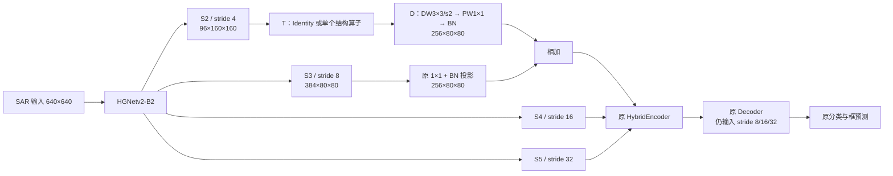

# S2 细节注入：固定设计与实验交接

状态：实现和配置已准备，实验尚未启动。启动脚本只在手动调用时执行，
没有排队、定时或自动续跑任务。当前先安排 B1；B2 和容量对照不自动接续。

## 研究问题与边界

SAR-AIRcraft-1.0 的既有分析中，640 输入下按 sqrt(box area) 计，
32–64 px 目标占验证 GT 的 61.8%，等效尺寸中位数约 42 px。
这相当于 stride-8 上约 5.3 格、stride-4 上约 10.5 格。
这里检验“更早的特征能否补充有效信息”，不把这个尺寸统计当成细节丢失
已经被证明的因果结论，也不预先承诺分类错误或 AP75 会改善。

方法借鉴 [SFG-Net 的浅层细节路径](https://www.mdpi.com/2072-4292/17/7/1193)
和 [Strip R-CNN 的条带算子](https://arxiv.org/abs/2501.03775)。
本实现是单模块迁移与路径对照，不是上述完整网络的复现。条带算子的
作者归属、许可证和改动见 [来源说明](strip_rcnn_notice.md)。

## 唯一新增的信息路径

HGNetv2-B2 原本计算四个 stage，但只返回 S3/S4/S5。
本组配置让 return_idx 从 [1,2,3] 改为 [0,1,2,3]，额外取出已有 S2；
不增加骨干 stage，不改变原来三个输出的计算。

以下尺寸对应输入 640×640，训练多尺度时等比例变化：



数学接口为：

    Y3 = Proj(S3) + D(T(S2))

D 固定为：96 通道 3×3 depthwise、stride=2、padding=1、无 bias；
1×1 投影 96→256、无 bias；256 通道 BN。D 中没有额外激活、门限、
融合系数或频域处理。它输出与 Proj(S3) 完全相同的空间尺寸，不用插值
或坐标修正兜底。注入点在 S3 投影之后、原 encoder/FPN/PAN 之前。

新路径使用独立的 s2_injection 参数，不能同时启用原 p2_channels 的
Haar 路径或 DPM。AFS、SPI、DSG、BCM、SCS、SLQC、MPQ 均在新配置中关闭。
不改 matcher、D-FINE FDR/LQE、原检测损失和推理后处理。

## 三个配置各自回答什么

| 标识 | 配置 | T 的操作 | 新增参数 | 640 单图卷积 GMACs |
|---|---|---|---:|---:|
| B0 | 原冻结 baseline | 无新增路径 | 0 | 0 |
| B1 | sar_aircraft_detail/s2_plain.yml | Identity | 25,952 | 0.162816 |
| B2 | sar_aircraft_detail/s2_strip.yml | 一个条带 Attention | 60,224 | 1.025434 |
| B2-L | sar_aircraft_detail/s2_local.yml | 同包装的普通局部卷积对照 | 59,840 | 1.015603 |

配置目录的完整前缀为 configs/deim_dfine/。参数量包括 BN affine；GMACs
按实际卷积核和 640 下特征尺寸计算，未计 BN、激活、逐元素运算和显存访问。
若约定一次乘加为 2 FLOPs，卷积 FLOPs 为该列的两倍。它们不代表实际 FPS
或训练显存，尚未进行服务器 GPU 性能测量。

**B1** 对照 B0：补充 S2 信息是否有价值。它是基础路径对照，不作为条带
结构创新。仓库已有 Haar/P2/DPM 研究实现，本组没有把这些旧模块换名。

**B2** 对照 B1：在同一路径增加条带结构处理是否有额外收益。T 的定义：

    U = GELU(PW_in(S2))
    A = PW_context(DW_19x1(DW_1x19(DW_5x5(U))))
    T(S2) = S2 + PW_out(U * A)

三个 PW 保持 96 通道，卷积 bias 沿用所借鉴的 Attention 操作；K 固定为 19，
不先做核尺寸搜索。没有 sigmoid、附加 MLP/FFN、LayerScale 或自定义损失。
标准 PyTorch Conv2d 初始化与最终注入 BN 零初始化共同构成本项目的初始化方式，
并非完整 StripNet 的 ImageNet 预训练或骨干初始化流程。

横纵条带串联具有二维有效感受野，不是只在十字线上采样；也不具备任意角度
旋转等变性。其响应不能直接解释为机翼、发动机或物理散射中心。

**B2-L** 只用于 B2 出现收益后的机制对照：把两层条带 depthwise 换成
5×5、3×3 depthwise，保留初始 5×5、所有 PW、GELU、乘法门控、残差及 D。
比 B2 少 384 个参数（约 0.64%）、卷积 MACs 少约 0.96%，属于接近开销的
局部卷积对照，并非精确等参数或等延迟。它同时改变方向性和感受野范围，
不能据此单独宣称收益只来自方向建模。

## 初始化、梯度与可诊断性

1. 新分支在原 encoder 层构造完之后、独立 RNG 上下文中创建，保留原层和
   后续 decoder 的初始化随机序列。D 先于 T 构造，B1/B2/B2-L 的 D 初始
   参数一致。这不意味着不同 DDP 完整训练会逐步数值一致。
2. 只把 D 最后 BN 的 gamma、beta 初始化为 0；卷积保持非零初始化。
   初始注入为零，完整 encoder 的原有三个输出保持一致。
3. 第一次反向传播时 BN affine 有梯度；BN gamma 更新后，梯度进入 D 的
   卷积与 T。没有给两个连续乘法门同时设零，所有新增参数都接入计算图。
4. 新分支参数进入原 AdamW：主学习率 3.5e-4，卷积 weight decay=1e-4；
   名称含 norm 的 BN 参数沿用零衰减。没有独立学习率、loss 权重或启用 epoch。
5. 分支始终保留在推理模型中，不需要 GT。模型/EMA checkpoint 自动保存其
   卷积、BN 参数和运行统计，恢复时必须使用同一模式的 resolved_config.yml。

新增诊断不参与 loss：

- log.txt 的 train_s2_residual_ratio：每个 batch 的 RMS(D(T(S2))) /
  RMS(Proj(S3))；epoch 指标汇总两卡。用于判断是否实际改变输入特征，
  不表示改变有益。分母的 1e-12 仅是诊断除零保护。
- train_s2_gamma_mean_abs：注入 BN gamma 的绝对均值。
- TensorBoard 对应 Module/s2_residual_ratio、Module/s2_gamma_mean_abs；
  沿用主进程的逐步记录，与 epoch 的两卡均值区分。

没有人为设定这些诊断的“达标值”。最初为 0 是预期行为；若后期一直为 0，
才检查支路学习；非零但 AP 不涨则不能继续以“没有启用”为解释。

## 冻结的训练与评价协议

三份配置继承 deim_hgnetv2_m_sar_aircraft_102e_b28.yml，仅改变上面的模型路径。

| 项目 | 固定值 |
|---|---|
| 数据 | /root/zxy/datasets/SAR-AIRcraft-1.0，COCO/train.json 与 COCO/val.json；3047/442 张，七类 0–6 |
| 初始化 | /root/zxy/pretrain/deim/deim_dfine_hgnetv2_m_coco_90e.pth，经 train.py -t；新增层保留自己的初始化 |
| GPU / batch | GPU0、1；全局 28，每卡 14 |
| 周期 / seed | 102 epochs，seed0 |
| 优化器 | AdamW，主 LR 3.5e-4、backbone LR 3.5e-5；WD 1e-4，Norm/BN 零衰减，betas=(0.9,0.999) |
| LR | flatcosine；warmup_iter=2000、flat_epoch=49、no_aug_epoch=12、lr_gamma=0.5 |
| 输入 | 基础及验证 640×640；训练 480–800、步长32，沿用原多尺度调度 |
| 增强 | 关闭 RandomZoomOut/RandomIoUCrop；保留原 Mosaic、MixUp、颜色扰动、水平翻转 |
| 强增强时段 | Mosaic/MixUp 按原 [4,49) 调度，PhotometricDistort 按 [4,90)，epoch90 停多尺度与相应增强 |
| 概率 | Mosaic 外层 .5，算子内 probability=1.0；MixUp .5；颜色扰动 .5；水平翻转 .5 |
| 精度与 EMA | SyncBN；AMP fp16、FP32 loss 与既有异常重试；EMA decay .9999/warmup1000；clip norm .1 |
| 验证 | 固定 val，FP32、640，原 top300/无NMS；COCO 指标 maxDets100，全局验证 batch64 |

基准 run 为 /root/zxy/experiments/deim_m_sar_aircraft_102e_b28_nozoom_nocrop_seed0_20261026_142643_LMw1Yy，
最佳 AP64.510414，逻辑 epoch90。MPQ 权重不用于本组初始化。
最后无强增强阶段的原 solver 行为（包含加载 best_stg1）完整保留。
测试集不用于挑选结构、核尺寸或权重。

## 实验判定顺序

- 先看 B1 对 B0，确认早期细节路径是否值得继续。B1 失败会削弱该假设，
  但不在逻辑上证明 B2 必然失败；是否继续由具体误差变化决定。
- B2 必须同时比较 B0/B1。只超越 B0、却不超越 B1，不能归功于条带结构。
- 若 B2 有收益，才考虑 B2-L，检查是否只是增加容量/普通空间处理即可达到。
- 主指标是同一最佳 AP checkpoint 的 AP、AP50、AP75、AR100；并看输入
  32–64 px 组、A220/ARJ21/other 类别 AP、同召回下的归一化混淆与背景 FP。
- 原图 COCO small 只有 1 个 GT，不作为方法成立的依据。前 20–40 轮曲线
  仅用于观察收敛，不据此宣布最终收益。小幅涨点后补 matched seeds1/2，
  不把单次最佳 epoch 的差异当成稳定提升。

## 已完成的本地功能验证与限制

使用 Windows Conda pytorch；tests/test_shallow_detail.py 的 7 项测试覆盖：
实际 HGNetv2-B2 的四层输出契约、初始 encoder 输出与 RNG 保持、共享 D 初始化、
原检测损失驱动的两次反向更新、各新增参数梯度连接、480/640/800 分支输入、
CPU BF16 autocast、非零分支的 checkpoint 恢复与 deploy 推理、完整 YAML 建模、
优化器参数组及冻结协议一致性、旧 Haar 路径不变。
原 tests/test_sar_module_integration.py 的 8 项回归验证也已通过，覆盖旧
DSG/SLQC/SCS 路由、默认配置隔离及诊断记录；合计 15 项通过。

可复核的本地命令（仓库根目录、Conda pytorch）：

```powershell
conda run -n pytorch python -m unittest discover -s tests -p test_shallow_detail.py -v
conda run -n pytorch python -m unittest discover -s tests -p test_sar_module_integration.py -v
```

验证没有使用真实 SAR 图像或 COCO 权重，没有运行训练 epoch；CPU BF16
不代替服务器 CUDA FP16/SyncBN/DDP 验证。未测实际训练显存、速度或精度收益。
不以任何冒烟测试或哈希校验作为启动前置条件。

## Linux 代码更新：仅更新，不启动

实际目录沿用本会话已确认的 /root/zxy/deim；环境为 deim_zxy。
先检查 git status 的本地变更；存在冲突或分歧时保留并检查，不执行 reset/强制 checkout。

```bash
cd /root/zxy/deim
git status --short
git fetch origin
git switch main
git pull --ff-only origin main
source /opt/miniconda3/etc/profile.d/conda.sh
conda activate deim_zxy
```

复用现有数据和标注，不需要重新准备数据。源代码通过 Git 传递；本地实现完成
不等于服务器 checkout 已更新。启动脚本会记录实际 revision、解析后的配置、
训练协议、模块选项、数据统计和 GPU 状态到全新的实验目录。

## 以后明确决定启动时使用的命令（本轮未执行）

B1：

```bash
cd /root/zxy/deim
source /opt/miniconda3/etc/profile.d/conda.sh
conda activate deim_zxy
bash tools/run_sar_module_experiment.sh configs/deim_dfine/sar_aircraft_detail/s2_plain.yml
```

B2 与 B2-L 分别用以下命令，单独选择，不连着执行：

```bash
bash tools/run_sar_module_experiment.sh configs/deim_dfine/sar_aircraft_detail/s2_strip.yml
```

```bash
bash tools/run_sar_module_experiment.sh configs/deim_dfine/sar_aircraft_detail/s2_local.yml
```

启动脚本只在 GPU0 和 GPU1 同时空闲时使用 CUDA_VISIBLE_DEVICES=0,1、
torchrun --standalone --nproc_per_node=2；不停止其他任务，不自动等待或排队。
正式进程通过 nohup 后台运行，stdin=/dev/null，stdout/stderr=console.log，
先保存 launcher.pid 再 disown。新目录包含方法名、seed、时间和随机后缀，
不会覆盖已有 run。脚本输出的 STARTED OUT=... 是后续日志命令的实际目录。

## 查看日志、GPU、指标与 TensorBoard

重连后重新激活环境，并把 OUT 设置为启动输出的实际目录：

```bash
source /opt/miniconda3/etc/profile.d/conda.sh
conda activate deim_zxy
OUT=/root/zxy/experiments/替换为实际STARTED目录
tail -n 80 -f "$OUT/console.log"
```

在另一终端查看运行状态和最新 epoch 指标：

```bash
nvidia-smi -i 0,1
ps -fp "$(cat "$OUT/launcher.pid")"
tail -n 1 "$OUT/log.txt"
tensorboard --logdir "$OUT/summary" --host 0.0.0.0 --port 6006
```

从同一最佳 AP epoch 提取指标（epoch 为 0 起始编号）：

```bash
python - "$OUT/log.txt" <<'PY'
import json
import sys
rows = [json.loads(line) for line in open(sys.argv[1]) if line.strip()]
row = max(rows, key=lambda x: x['test_coco_eval_bbox'][0])
m = row['test_coco_eval_bbox']
print(dict(epoch=row['epoch'], AP=100*m[0], AP50=100*m[1], AP75=100*m[2], AR100=100*m[8]))
print({k: v for k, v in row.items() if k.startswith('train_s2_')})
PY
```

COCO 评估数据位于 eval/latest.pth；它对应最近一次评估，不保证是最佳 checkpoint。

## 恢复与评估（本轮未执行）

恢复只针对已停止且需要继续的 run，使用其保存配置、模型、optimizer 和 EMA：

```bash
cd /root/zxy/deim
source /opt/miniconda3/etc/profile.d/conda.sh
conda activate deim_zxy
OUT=/root/zxy/experiments/替换为实际STARTED目录
bash tools/run_sar_module_experiment.sh --resume "$OUT"
```

恢复脚本同样检查两卡、后台执行并记录单独的 resume_*.console.log。
原 solver 仅在无强增强阶段前更新 last.pth；它不保证对应最后 epoch。
本组不改变该行为，不把 best_stg2.pth 直接当作“最终轮”或默认最优。

按 log.txt 最佳 AP 和保存记录选择 best_stg1.pth 或 best_stg2.pth。
例如最佳位于 stage2 时的两卡评估命令为：

```bash
cd /root/zxy/deim
CUDA_VISIBLE_DEVICES=0,1 torchrun --standalone --nproc_per_node=2 train.py \
  -c "$OUT/resolved_config.yml" -r "$OUT/best_stg2.pth" --test-only
```

若 stage1 的 AP 更高，将 -r 改为对应 best_stg1.pth。新训练只用 -t COCO 权重；
恢复或评估只用 -r，不同时提供两者。
