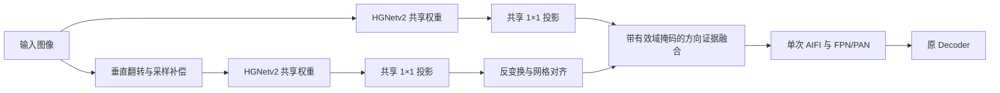

# E013-v2：方向共享骨干与投影空间证据融合

2026-11-12。用户授权完成结构调整，并在 8 卡服务器的 GPU 4、5 正式训练。
这是一项待实验验证的主方法候选；设计依据与功能正确性支持启动，不把提前证明 AP 增益作为启动条件。
原 E013 的代码和配置保留，本版本使用独立配置及新输出目录。

## 问题、依据和边界

D17 显示 E000 对图像方向有很强的依赖；垂直翻转会使整体 AP 下降，但能检出部分原图漏掉的无副本 aircraft、bridge。
这支持“不同方向的响应存在互补性”，不证明强制方向不变会提高原图 AP，也不等于解释了全部跨来源差异。
D18 的裁块任务中，方向增强降低原方向召回，双视图融合未显示收益。这是负面信号，不能直接外推到包含定位和上下文的检测器。

设计假设：保留原始方向作为参照，通过共享参数提取另一方向的响应，在统一网格上选择补充证据；由一个公共编码器形成跨尺度检测特征。
主要观察对象为没有副本的 aircraft 和 bridge；小 tank 没有一致的方向互补证据，不预设它一定受益。
上下翻转是数字图像变换，不模拟雷达改变观测方位后的真实散射。

## 结构



令 B 为骨干，P_l 为原 encoder 的第 l 个投影，A_l 为反变换及采样补偿：

F0_l = P_l(B(x)_l)，F1_l = A_l(P_l(B(Tx)_l))。

将 [F0_l, F1_l] 输入逐层门控：512→64 的 1×1 Conv、BN、ReLU、64→16 的 1×1 Conv。
将 16 通道解释为两个方向、八个通道组，对方向维 softmax；每组的 32 个特征通道共享一个位置权重。
输出 Z_l = w0_l F0_l + w1_l F1_l，然后只执行一次原 AIFI、FPN、PAN 和 Decoder。
两路不加特征一致性损失，也不强制权重在交换视图时对称，因此不声称严格翻转等变。

末层门控权重为零，原图 logit 偏置为 2，内部有效位置初始 w0=0.8808。
这只是较接近原输入的初始化，不是严格恒等；门控取原图一路的极限才恢复基线。
公式亦可写成 Z=F0+w1(F1-F0)，无需再堆叠一个同义的残差模块。

## 网格补偿及边界

HGNetv2 的 stem 包含偶数核、右/下填充和下采样。设一个路径的采样中心为 a+s*j，
图高 H、输出高 N，则镜像再翻回的偏移为 H-1-2a-s(N-1)。对 H=s*N，是 s-1-2a。
stem 的池化路径名义 a=1、卷积路径 a=2；三像素输入平移与一格输出补偿消去主路径的 s-3 偏移，
不能令所有路径严格等变。该常量来自结构几何与对称核标定，不根据 val AP 搜索；480..800 的协议尺寸均为 32 的倍数。

v2 只在投影特征上对齐：此处尚未引入位置编码与跨尺度混合。相比 v1 在完整 encoder 后对齐，
避免了把两套 FPN/PAN 内已混合的路径偏差再用一个整体平移修正。
整数倍最近邻上采样本身可与翻转交换顺序；v1 的残差不能简单归结为“最近邻天生不可对齐”。

特征平移生成的空行被标记为无效，该方向的 softmax logit 设为负无穷，原图权重自动为 1。
掩码表达采样支持有效域，不表示普通卷积边界感受野完全不受填充影响。

## 检查点与 SyncBN

新版本开关 checkpoint_views 时都按“原图、翻转图”的相同顺序分视图编码。
每个真实前向更新一次 backbone/投影 BN 的滑动统计，每个训练批次共两次；每个视图通过 SyncBN 跨两张卡同步。
这项批次组织是 v2 的固定定义，不因显存开关改变。

检查点仅包住共享 backbone 和 input_proj，使用 use_reentrant=False。
重计算使用临时 BN/SyncBN 滑动统计缓冲区，结束时恢复原缓冲区引用，保留训练模式、批次统计、仿射参数梯度和同步通信。
不用 eval 模式替代重计算，不额外更新真实 running_mean、running_var 或 num_batches_tracked。
后续 AIFI/FPN/PAN、门控和 Decoder 只正常执行，不做额外重计算。

v1 的检查点开关会从合并批次变为分视图，并重复更新 BN；其原卷积测试未覆盖 BN。
这项历史局限不通过更改 v1 配置悄悄消除，正式运行使用本版本。

## 计算预算

640×640、单张输入、eval 模式、未做部署重参数化；使用仓库 calflops 口径，属于算子预算而非 GPU 延迟。

| 项目 | E000 | E013-v1 | E013-v2 |
|---|---:|---:|---:|
| 参数 | 19,476,030 | 19,577,838 | 19,577,838 |
| 前向 GFLOPs | 57.70 | 111.24 | 79.06 |
| 相对基线 | 1.00 | 1.93 | 1.37 |

对实际 v2 模型的前向计数为 79,064,801,568 FLOPs 和 39,377,201,600 MACs。增加的计算来自第二次 backbone、input_proj 及门控。
参数增加仍为 101,808；COCO 原有参数名及形状保留。训练时间与峰值显存用正式日志实测，不沿用 v1 的 36–40 小时估计。
门控提前使用尚未跨尺度混合的特征，可能削弱选路能力；这是需由实验回答的结构取舍。

## 固定实验协议

| 项目 | 设置 |
|---|---|
| 对照 | E000，val AP 65.29，revision 455b196 |
| 配置 | configs/deim_dfine/deim_hgnetv2_m_sardet100k_orientation_fusion_v2_36e_b32.yml |
| 数据 | SARDet-100K 官方 train 94,493 / val 10,492；原注释与六类零基标签 |
| 路径 | /root/zxy/TCRA-SAR/datasets/SARDet_100K/JPEGImages/{train,val}；Annotations/{train,val}.json |
| 初始化 | -t /root/zxy/pretrain/deim/deim_dfine_hgnetv2_m_coco_90e.pth |
| 设备 / seed | CUDA_VISIBLE_DEVICES=4,5；两进程；seed 0 |
| batch / 分辨率 | 全局 32，每卡 16；基准和验证 640，训练多尺度 480..800 |
| 训练 | 36 轮，flat 20，末 4 轮无增强，warmup 2000 步 |
| 优化 | AdamW；主 LR 4e-4、骨干 4e-5、WD 1e-4；继承 E000 分组 |
| 增强 | E000 Dense O2O/Mosaic/MixUp/水平翻转不变；关闭 ZoomOut、IoUCrop |
| EMA / AMP | EMA 0.9999；FP16、FP32 loss、非有限批次同批 FP32 重算 |
| 检测部分 | Decoder、匹配和损失保持 E000 |
| 评估 | 每轮完整 val，COCO bbox；依据 val AP 选 checkpoint，不用 test 调整方法 |

首轮重点观察是否收敛及实际资源开销；结构成功由完整协议后的 AP 与无副本目标分组评价决定。
沿用暂定 val +0.5 AP 筛选线，但单种子结果不表述成稳定统计结论。
门控均值仅作描述，不要求翻转权重大于 12%。更有用的机制证据是无副本 aircraft/bridge 改善，以及移除翻转分支后收益减少。
若候选有收益，再安排普通垂直翻转增强、固定融合及计算量接近的单路对照；本次不同时启动这些消融。

## D18 更正

- 原统计比较上下/左右像素总和；奇数尺寸的下/右区域多一行/列，均匀 5×5 框也会得到 -0.2。
  脚本已改为区域平均值，重新提取写入 statistics_version=half_means_v2。旧结果保留并标记，不冒充已经重算。
- 宽度翻倍实际约 21.70 M MACs，是单视图 5.54 M 的 3.92 倍；双视图是 11.33 M（2.04 倍）。
  宽度翻倍接近四视图的计算量，不能称作双视图的等计算量对照。
- C 的增强下降和 D 的双视图未获益仍然成立；完整检测器的结论等待训练。修正 A 不要求在本次启动前重跑全部裁块实验。

## 功能验证与记录

本地定向验证：检查点前后输出、所有编码/门控梯度、两次优化中的 BN 状态；覆盖固定与累计 BN momentum；
无效边界不能被门控选择；基线全部权重可载入；原图门控恢复基线；两次骨干、一次 AIFI/FPN；D18 均匀奇数框统计为零。

```bash
python -m unittest discover -s tests -p 'test_orientation*.py' -v
```

针对真实 backbone/投影的双卡 SyncBN 重计算一致性：

```bash
CUDA_VISIBLE_DEVICES=4,5 torchrun --standalone --nproc_per_node=2 tests/check_orientation_fusion_v2_ddp.py
```

正式 launcher 保存 resolved_config.yml、run_metadata.json、Git revision、启动脚本和 launcher.pid。
训练 log.txt 与 TensorBoard 的 Module/ 下记录 orientation_vflip_p3/p4/p5，以及 *_gt_center。
GT 中心指标是每批次目标中心的平均权重，不是按来源或无副本标签分组的因果证据。

## 服务器更新、启动、恢复与评估

用户本次明确指定 8 卡服务器，使用 /root/zxy/deim 和 GPU 4、5。工作区脏或分叉时先检查，不做覆盖。

```bash
cd /root/zxy/deim
source /opt/miniconda3/etc/profile.d/conda.sh
conda activate deim_zxy
git status --short --branch
git fetch origin
git switch main
git -c pull.rebase=false pull --ff-only origin main
git rev-parse --short HEAD
export CFG=configs/deim_dfine/deim_hgnetv2_m_sardet100k_orientation_fusion_v2_36e_b32.yml
GPU_IDS=4,5 EXPERIMENT_ROOT=/root/zxy/experiments \
INITIAL_WEIGHTS=/root/zxy/pretrain/deim/deim_dfine_hgnetv2_m_coco_90e.pth \
RUN_PREFIX=orientfusion_v2 bash tools/run_sar_module_experiment.sh "$CFG"
```

数据无需重新准备。launcher 新建目录，执行 nohup，stdout/stderr 写 console.log，stdin 为 /dev/null，
后台后先保存 $! 到 launcher.pid 再 disown；不覆盖其他运行，不停止其他 GPU 进程。

重连后将 OUT 设置为实际启动输出目录：

```bash
cd /root/zxy/deim
source /opt/miniconda3/etc/profile.d/conda.sh
conda activate deim_zxy
export OUT=/root/zxy/experiments/<实际运行目录>
tail -f "$OUT/console.log"
```

其他终端查看进程、GPU、指标和 TensorBoard：

```bash
nvidia-smi -i 4,5
ps -p "$(cat "$OUT/launcher.pid")" -o pid,etime,args
tail -n 5 "$OUT/log.txt"
tensorboard --logdir "$OUT/summary" --host 127.0.0.1 --port 6006
```

训练停止后恢复同一个实验，不同时使用 -t 和 -r：

```bash
GPU_IDS=4,5 bash tools/run_sar_module_experiment.sh --resume "$OUT"
```

恢复日志为 OUT/resume_<时间>.console.log。last.pth 仅在无增强阶段之前更新；当前 solver 另存 final.pth，
但最终权重仍依据 AP 选择，不能仅凭 best_stg1/best_stg2 的名字判断。

查看最近指标并选择 val 最优权重：

```bash
python - <<'PY'
import json, os
from pathlib import Path
root = Path(os.environ['OUT'])
rows = [json.loads(line) for line in (root / 'log.txt').read_text().splitlines() if line.strip()]
for row in rows[-5:]:
    print(row['epoch'] + 1, dict(zip(('AP', 'AP50', 'AP75'), [round(100*x, 2) for x in row['test_coco_eval_bbox'][:3]])))
best = max(rows, key=lambda row: row['test_coco_eval_bbox'][0])
checkpoint = root / ('best_stg2.pth' if best['epoch'] >= 32 else 'best_stg1.pth')
print('Best val AP:', 100 * best['test_coco_eval_bbox'][0], 'epoch:', best['epoch'] + 1, 'checkpoint:', checkpoint)
PY
```

把 CKPT 设置为上面选出的实际文件，重新评估完整 val：

```bash
export CKPT="$OUT/best_stg2.pth"  # 仅当上面的 AP 选择结果为 best_stg2 时使用
CUDA_VISIBLE_DEVICES=4,5 torchrun --standalone --nproc_per_node=2 train.py \
  -c "$OUT/resolved_config.yml" -r "$CKPT" --test-only --use-amp \
  --output-dir "$OUT/val_recheck"
```

逐轮指标为 log.txt，TensorBoard 事件为 summary/，COCO 评估数据为 eval/latest.pth。
COCO bbox 的 0、1、2 项是 AP@[.50:.95]、AP50、AP75，原始 0..1 值乘 100 报告。

## 本次验证与运行记录

待记录本地验证、双卡数值验证和正式启动的实际输出。完整训练尚无结果。
