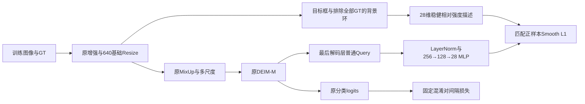

# M1：SCS 散射描述引导的类别分离

独立配置：`configs/deim_dfine/deim_hgnetv2_m_sar_aircraft_scs_m1_102e_b28.yml`。
继承已完成的 SAR-AIRcraft DEIM-M baseline；不修改旧配置或结果。
初版参数预先固定，不宣称已经验证有效，不用 test 选择类别对或超参数。

## 模块与监督



背景环以 GT 中心向外扩至宽高的 2 倍，裁到图像边界，排除图中所有 GT 区域。
对背景像素计算 `median` 与 `1.4826*MAD + 1/255`，得到
`Z=clip((I-median)/scale,-5,5)`。RGB 在转为 [0,1] 张量后取通道均值作为灰度。
本描述是显示强度的相对统计，不是定标后的散射截面。

28 维由以下项目拼接：

- 16 维空间分布：对 Z 做 4×4 自适应平均池化，除以 5，范围 [-1,1]。
- 8 维强度直方图：[-5,5] 等宽区间，以目标框像素数归一化。
- 4 维局部结构：Sobel 梯度幅值加权的无向角度区间 [0,π)，每段 π/4，归一化为分布；
  常量区域为全零。replicate padding 避免凭空制造边界梯度。

可用背景不足 16 像素时标记描述无效，仅跳过该实例的描述监督，不删除检测 GT。
描述在 Mosaic、光度变换、翻转和基础 Resize **之后**，MixUp 和多尺度 **之前**提取。
MixUp 按原 boxes/labels 拼接顺序同步拼接描述与有效掩码；不从混合像素生成相互污染的 GT 描述。
多尺度沿用归一化目标框；描述是 640 基础视图的实例教师，不声称逐尺度完全一致。

辅助头使用最后一层 **实际解码隐藏 Query**，去掉 DN 前缀后才预测普通 Query 的描述，
不是用初始 encoder seed。只监督最后层原 Hungarian 正匹配，不使用 union、DN、encoder 或 aux 匹配。
Smooth L1 beta=0.1，每个实例先对 28 维取均值，再对有效正匹配取均值。
梯度流向描述头与解码器；GT 描述无梯度。

## 混淆对和损失

基于 baseline val 的 classification/class+loc 预测关联，排除 `other` 后，
无向累计次数至少 10 的类别对固定为：

| 类别对 | baseline 关联数（不是唯一 GT 数） |
|---|---:|
| ARJ21 ↔ Boeing737 | 30 |
| A220 ↔ Boeing787 | 15 |
| A220 ↔ ARJ21 | 15 |

截图里的 ARJ21/Boeing787 是示例，本次实际关联仅 1 次，不列为高混淆对。
集合按两个方向固定，最终方向权重只由 **train** 中 rival 类频次决定：
`w(c,k)=n_k^(-1/2) / sum_{r in H(c)} n_r^(-1/2)`。
使用的 train 计数：A220=3023、ARJ21=447、Boeing737=1755、Boeing787=1930。
精确权重写在配置中，可从上述公式直接复算；不是把 val 关联次数当最终权重。

`L_pair = sum_positive sum_rival w(c,k)*relu(0.5-(z_c-z_k)) / N_positive`。
分母包含所有普通正匹配；没有 rival 的类别贡献零。`other` 不参与 pair loss，
但仍可接受逐实例描述回归，不将全部 other 拉向同一中心。
两项分母跨 DDP rank 归一化；无正样本/无有效描述时仍保留零梯度路径。

**最终增加 `1.0*L_sig + 0.1*L_pair`**。使用原分类 logit，不改变原分类头、匹配代价、
类别数、bbox 或后处理。推理不计算描述头、不需要 GT/背景环，也不额外改分数。
M 增加训练参数 37,020；deploy 移除辅助头。构造辅助头时保留原随机状态，
避免额外初始化改变公共参数或后续 denoising 随机序列。

## 固定训练协议

SAR-AIRcraft 原 train3047/val442/test879；7类；DEIM-D-FINE-M。
GPU0/1，global batch28（每卡14），seed0，102 epochs。
从 `/root/zxy/pretrain/deim/deim_dfine_hgnetv2_m_coco_90e.pth` 用 `-t` 初始化，
新建优化器，不从 baseline 最佳权重接着训练。
AdamW：主 LR3.5e-4、backbone非BN3.5e-5、WD1e-4、Norm/BN WD0、betas(.9,.999)。
flatcosine、warmup2000、flat49、最小LR比例0.5；epoch90起最后12轮。
保留训练480–800多尺度、Mosaic/MixUp与原调度；仅原协议已关闭的ZoomOut/IoUCrop关闭。
基础与验证640；EMA(.9999,warmup1000)、SyncBN、AMP FP16、FP32 loss/retry、clip0.1均沿用。
数据采样、batch、训练/评估精度和后处理不改变。完整 baseline 细节见
[固定协议](sar_aircraft_deim_m_protocol.md)。

## 功能验证

`tests/test_scattering_signature.py` 检查描述范围/常量/无环、强度仿射变化与邻框排除、
MixUp 图像保持原样且描述顺序正确、仅匹配 Query 接收相应梯度、无正样本、
DN 切分、最后层梯度、启用头前后的公共参数/检测输出和推理输出逐值一致、
训练协议与 baseline 相同、权重由 train 计数计算。
这些是改动相关的功能回归，不做哈希校验或额外启动前试跑。
正式训练日志新增 `loss_scs_sig`、`loss_scs_pair` 与 `scs_valid_fraction`。

## 服务器更新与条件启动

```bash
cd /root/zxy/deim
git status --short --branch
git fetch origin
git switch main
git pull --ff-only origin main
source /opt/miniconda3/etc/profile.d/conda.sh
conda activate deim_zxy
bash tools/run_scs_m1_if_idle.sh
```

GitHub HTTPS 不通可用 Git bundle 的 fetch 与 `merge --ff-only`；不 reset 或强制切换。
启动器创建新目录、保存解析配置/协议/metadata/revision，临近启动检查两卡。
只有 GPU0 和 GPU1 均无计算进程、utilization=0、显存≤256MiB 时才启动。
任一卡忙则写 `NOT_STARTED.txt` 并退出，不排队、不等待后自动启动，不停止别人的进程。
实际 nohup 命令、launcher PID、显存检查与日志保存在新目录。
没有数据准备步骤；使用现有 COCO 标注。

## 重连、指标、评估与恢复

重新激活环境，并把 OUT 设为启动器打印的实际新目录：

```bash
source /opt/miniconda3/etc/profile.d/conda.sh
conda activate deim_zxy
cd /root/zxy/deim
OUT=/root/zxy/experiments/替换为启动器输出的SCS目录
tail -f "$OUT/console.log"
tail -n 3 "$OUT/log.txt"
ps -p "$(cat "$OUT/launcher.pid")" -o pid,etime,args
watch -n 2 nvidia-smi
tensorboard --logdir "$OUT/summary" --host 0.0.0.0 --port 6006
```

原 JSONL 的 test_coco_eval_bbox 实际是 val；0/1/2 为 AP/AP50/AP75，8 为 AR100，乘100。
TensorBoard 仍写 summary/；COCO缓存 eval/latest.pth；最佳权重 best_stg1/2 按真实 AP 选。
last.pth 仅强增强停止前更新，不能当最终权重；收尾回载可能让 checkpoint last_epoch 回退。

重评 val（仅双卡都空闲时执行；不改训练输出；test 留给最终评估）：

```bash
EVAL=$(mktemp -d "$OUT/val_recheck_XXXXXX")
ulimit -Sn 65535
nohup env CUDA_VISIBLE_DEVICES=0,1 torchrun --standalone --nproc_per_node=2 train.py \
  -c "$OUT/resolved_config.yml" -r "$OUT/best_stg1.pth" --test-only --use-amp \
  --output-dir "$EVAL" --summary-dir "$EVAL/summary" > "$EVAL/console.log" 2>&1 < /dev/null &
PID=$!
printf '%s\n' "$PID" > "$EVAL/launcher.pid"
disown "$PID"
```

只恢复已中断且已停止的 SCS 运行，仍先确认0/1同时空闲，不同时提供-t/-r：

```bash
RLOG="$OUT/resume_$(TZ=Asia/Shanghai date +%Y%m%d_%H%M%S).console.log"
ulimit -Sn 65535
nohup env CUDA_VISIBLE_DEVICES=0,1 PYTHONUNBUFFERED=1 torchrun --standalone --nproc_per_node=2 train.py \
  -c "$OUT/resolved_config.yml" -r "$OUT/last.pth" --seed 0 --use-amp \
  --output-dir "$OUT" --summary-dir "$OUT/summary" > "$RLOG" 2>&1 < /dev/null &
PID=$!
printf '%s\n' "$PID" > "$OUT/launcher.pid"
disown "$PID"
tail -f "$RLOG"
```
